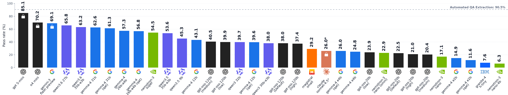
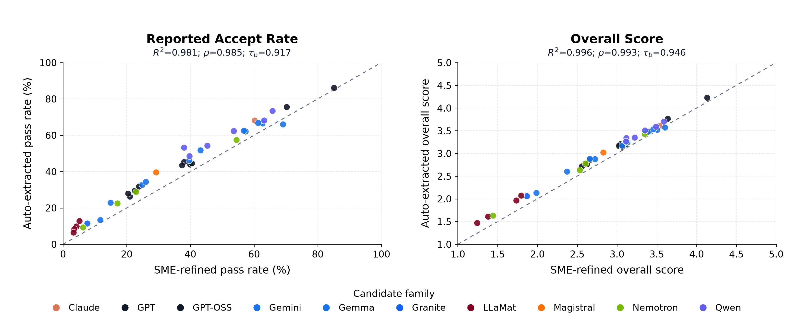
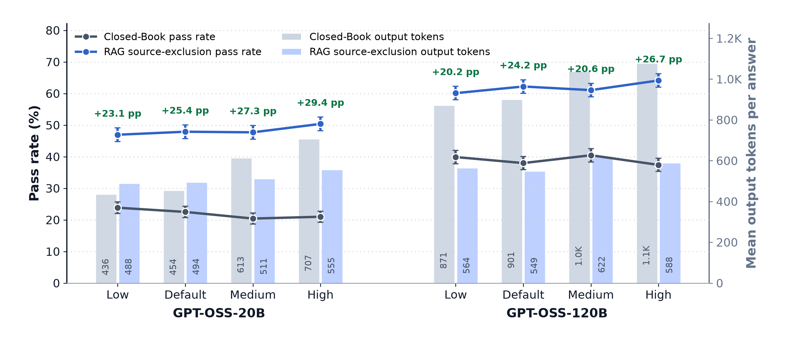

# SprayBench

Data and results for [*SprayBench: Benchmarking LLMs on Open-Ended Materials Reasoning in Additive Manufacturing*](paper/camera_ready.pdf), presented at the NeurIPS 2026 AI4Mat workshop. The benchmark asks models to explain cold-spray process choices, materials mechanisms, and mechanical behavior against expert-refined reference answers.



*Figure 1. Closed-book pass rates for the primary model configurations. The dashed line is the automated question-answer extraction baseline; lock icons mark API-accessible models.*

**Table 1. Matched RAG pass rates (%).** Gains in parentheses are relative to closed-book performance.

| Model | Closed book | Source excluded | Source eligible |
| --- | ---: | ---: | ---: |
| GPT-5 mini | 85.1 | 88.2 (+3.1) | 91.4 (+6.3) |
| Qwen3.6 35B A3B | 63.3 | 73.2 (+9.9) | 77.2 (+14.0) |
| Gemma4 26B-A4B | 57.3 | 61.1 (+3.8) | 65.7 (+8.4) |
| Nemotron3 Super | 54.5 | 71.9 (+17.4) | 74.8 (+20.3) |
| GPT-OSS 120B | 38.0 | 62.2 (+24.2) | 68.3 (+30.3) |
| Gemma4 E4B | 24.8 | 49.8 (+25.0) | 51.9 (+27.1) |
| GPT-OSS 20B | 22.5 | 47.9 (+25.4) | 51.0 (+28.4) |

## Data and outputs

[Questions and SME-refined target answers](data/SprayBench.json) retain their original order, category, complexity level, and source article title. [The model roster](data/model_roster.csv) and [closed-book](results/model_pass_rates.csv) and [RAG](results/rag_model_comparison.csv) summaries are plain CSV.

Each model's plain-text JSONL outputs live under `results/models/`. Reasoning settings have separate directories; models without a reasoning setting use `default`.

```text
results/models/<model>/<reasoning>/
  closed_book/answers.jsonl
  closed_book/reviews.jsonl
  rag/source_excluded/answers.jsonl
  rag/source_excluded/reviews.jsonl
  rag/source_eligible/answers.jsonl
  rag/source_eligible/reviews.jsonl
```

Only configurations evaluated in the paper have files. For example, [GPT-OSS-20B high-reasoning, source-excluded answers](results/models/gpt-oss-20b/high/rag/source_excluded/answers.jsonl) can be inspected directly. `question_id` joins questions, answers, and reviews. Answer records include status, response text, runtime, and token use; review records include the reviewer, iteration, pass/fail decision, and rubric scores. Failed attempts remain visible with their status. Full provider payloads and retrieved article text are not redistributed.

## Additional Results



*Figure 3. Model-level pass-rate and overall-score alignment when judging against auto-extracted versus SME-refined reference answers.*



*Figure 5. GPT-OSS reasoning settings: closed-book and source-excluded RAG pass rates alongside output-token use.*

<details>
<summary>Table 4. Models evaluated in the primary study</summary>

Active and total parameter counts are in billions; dashes indicate undisclosed API-model sizes.

| Model | Year | Company | Access | Active B | Total B | Modality |
| --- | ---: | --- | --- | ---: | ---: | --- |
| `qwen3.5-35b-a3b` | 2026 | Alibaba | Open weights | 3 | 35 | Text-only |
| `qwen3.5-9b` | 2026 | Alibaba | Open weights | 9 | 9 | Text-only |
| `qwen3.6-27b` | 2026 | Alibaba | Open weights | 27 | 27 | Text-only |
| `qwen3.6-35b-a3b` | 2026 | Alibaba | Open weights | 3 | 35 | Text-only |
| `qwen3-30b-a3b` | 2025 | Alibaba | Open weights | 3.3 | 30.5 | Text-only |
| `qwen3-32b` | 2025 | Alibaba | Open weights | 32.8 | 32.8 | Text-only |
| `claude-sonnet-4-5` | 2025 | Anthropic | API | -- | -- | Multimodal |
| `gemma-4-12b` | 2026 | Google | Open weights | 11.9 | 11.9 | Multimodal |
| `gemma-4-12b-qat` | 2026 | Google | Open weights | 11.9 | 11.9 | Multimodal |
| `gemma-4-26b-a4b` | 2026 | Google | Open weights | 3.8 | 25.2 | Multimodal |
| `gemma-4-26b-a4b-qat` | 2026 | Google | Open weights | 3.8 | 25.2 | Multimodal |
| `gemma-4-31b` | 2026 | Google | Open weights | 30.7 | 30.7 | Multimodal |
| `gemma-4-31b-qat` | 2026 | Google | Open weights | 30.7 | 30.7 | Multimodal |
| `gemma-4-e2b` | 2026 | Google | Open weights | 2.3 | 5.1 | Multimodal |
| `gemma-4-e2b-qat` | 2026 | Google | Open weights | 2.3 | 5.1 | Multimodal |
| `gemma-4-e4b` | 2026 | Google | Open weights | 4.5 | 8 | Multimodal |
| `gemma-4-e4b-qat` | 2026 | Google | Open weights | 4.5 | 8 | Multimodal |
| `gemini-3-flash-preview` | 2025 | Google | API | -- | -- | Multimodal |
| `granite-4-h-tiny` | 2025 | IBM | Open weights | 1 | 7 | Text-only |
| `magistral-small` | 2025 | Mistral AI | Open weights | 24 | 24 | Text-only |
| `nemotron-3-nano-4b` | 2026 | NVIDIA | Open weights | 4 | 4 | Text-only |
| `nemotron-3-nano-omni` | 2026 | NVIDIA | Open weights | 3.2 | 33 | Multimodal |
| `nemotron-3-super` | 2026 | NVIDIA | Open weights | 12 | 120 | Text-only |
| `nemotron-3-nano` | 2025 | NVIDIA | Open weights | 3.2 | 31.6 | Text-only |
| `gpt-5-mini` | 2025 | OpenAI | API | -- | -- | Multimodal |
| `gpt-oss-120b` | 2025 | OpenAI | Open weights | 5.1 | 117 | Text-only |
| `gpt-oss-120b-high` | 2025 | OpenAI | Open weights | 5.1 | 117 | Text-only |
| `gpt-oss-120b-low` | 2025 | OpenAI | Open weights | 5.1 | 117 | Text-only |
| `gpt-oss-120b-medium` | 2025 | OpenAI | Open weights | 5.1 | 117 | Text-only |
| `gpt-oss-20b` | 2025 | OpenAI | Open weights | 3.6 | 21 | Text-only |
| `gpt-oss-20b-high` | 2025 | OpenAI | Open weights | 3.6 | 21 | Text-only |
| `gpt-oss-20b-low` | 2025 | OpenAI | Open weights | 3.6 | 21 | Text-only |
| `gpt-oss-20b-medium` | 2025 | OpenAI | Open weights | 3.6 | 21 | Text-only |
| `o4-mini` | 2025 | OpenAI | API | -- | -- | Multimodal |

</details>

## Citation

```bibtex
@inproceedings{price2026spraybench,
  title     = {{SprayBench}: Benchmarking {LLMs} on Open-Ended Materials Reasoning in Additive Manufacturing},
  author    = {Price, Stephen and Sousa, Bryer C. and Flynn, Ronan and Judd, Kiran G. and Rundensteiner, Elke A. and Cote, Danielle L.},
  booktitle = {AI4Mat: AI for Accelerated Materials Design Workshop at NeurIPS},
  year      = {2026}
}
```
